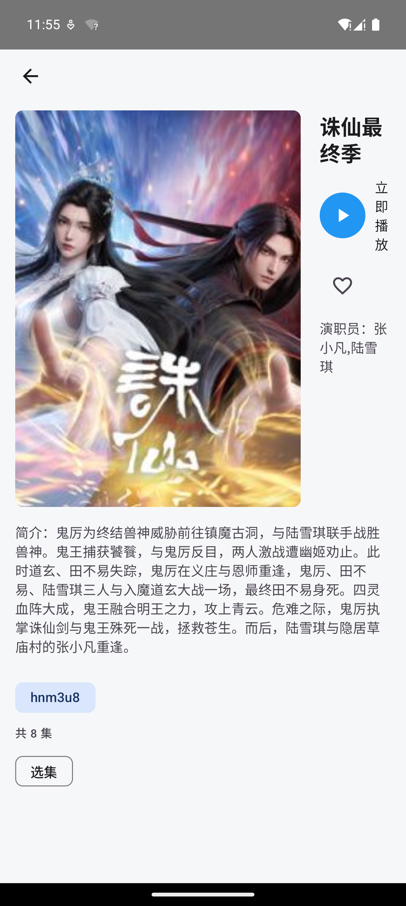
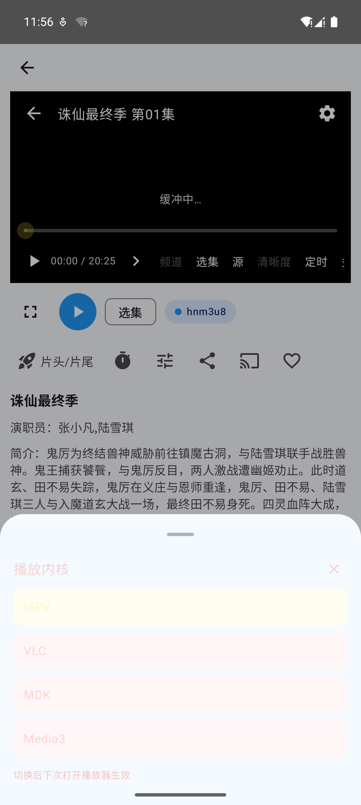

# ShijieCmp（视界）

基于 **Kotlin Multiplatform + Compose Multiplatform** 的双端影视聚合播放器，一套 `cmpMain` 共享 UI 同时驱动 **Android** 与 **Windows 桌面**，兼容 TVBox 配置与爬虫源生态。

| 首页/详情 | 播放器 |
| --- | --- |
|  |  |

## 功能特性

- **点播聚合**：TVBox 配置导入（多仓库源），首页分类浏览、详情多线路、选集播放、跨源搜索
- **直播**：TVBox 直播源播放，频道切换
- **网页嗅探**：`parse=1` 源经内嵌 WebView 嗅探真实播放地址
- **播放内核四选一**：MPV / VLC / MDK（JNA 绑定原生内核）+ Media3/ExoPlayer，切换后下次播放生效
- **切片广告过滤**：列表级 + m3u8 播放级双重过滤（URL 关键词、`DISCONTINUITY` 启发式检测、目录指纹规则，可处理加密广告分片），由 `filterSliceAd` 开关统一控制
- **收藏与历史**：Room 持久化，断点续播、追更记录
- **B 站源支持**：清晰度切换（qn）
- **局域网投屏接收**：接收外部推送的直链并在独立播放窗承载
- **Android 专属**：
  - 扫码导入 TVBox 配置（CameraX + ZXing）
  - 下载导出（Media3 Transformer 将 HLS 转封装为 MP4）
  - 画中画（PiP）

## 技术架构

```text
├── bridge        纯 JVM 桥接层：catvod Java/Kotlin 桥 + android.* 桩 + FtyGuardEngine（unidbg）
├── shared        KMP 数据 + 引擎层
│   ├── commonMain  纯 Kotlin 接口（PlayerKernel 等）
│   ├── jvmCommon   Android/JVM 共享中间源集（gson/okhttp/nanohttpd）
│   ├── androidMain DexClassLoader 爬虫 jar 运行时
│   └── jvmMain     dex2jar 爬虫转换、unidbg、JNA 播放内核绑定（mpv/vlc/mdk）、NanoHTTPD 代理
└── composeApp    Compose Multiplatform UI
    ├── cmpMain     Android/Desktop 共享 UI（首页/搜索/直播/详情/我的/设置）
    ├── androidMain 应用入口 + Android 平台实现（Media3、CameraX、下载、投屏）
    └── desktopMain 桌面入口 + JNA 播放内核装配
```

核心链路：爬虫 jar 在 Android 上经 `DexClassLoader` 直接加载，在桌面端先经 dex2jar 转换再加载；播放流量经 NanoHTTPD 本地代理（SpiderProxyServer）统一路由。

## 技术栈

| 类别 | 选型 |
| --- | --- |
| 语言/框架 | Kotlin 1.9.24、Compose Multiplatform 1.6.11、AGP 8.9.2、JDK 17 |
| 数据 | Room 2.6.1、DataStore Preferences |
| 网络 | OkHttp 4.12、Retrofit 2.9、Gson 2.10.1、Jsoup |
| 播放 | Media3 1.5.1（Android）、libmpv / libvlc / MDK via JNA（桌面） |
| 爬虫生态 | DexClassLoader、dex2jar、unidbg、BouncyCastle、SQLite JDBC |
| 其他 | NanoHTTPD（本地代理/投屏）、CameraX + ZXing（扫码） |

## 构建

### 环境要求

- JDK 17
- Android SDK（compileSdk 36 / minSdk 24 / targetSdk 34）
- Windows 10+（桌面打包；macOS/Linux 可运行开发调试但安装包产物仅配置了 MSI/EXE）

### Android APK

```bash
# Release（R8 混淆；无 CI 签名环境变量时自动回退 debug 签名，可直接安装）
gradlew :composeApp:assembleRelease
# 产物：composeApp/build/outputs/apk/release/
```

签名发布：设置 `KEYSTORE_PATH`、`KEYSTORE_PASSWORD`、`KEY_ALIAS`、`KEY_PASSWORD` 环境变量后构建，即用正式签名。

### Windows 桌面安装包

```bash
# MSI + EXE（jpackage，自动捆绑 mpv/vlc/mdk 原生内核）
gradlew :composeApp:packageDistributionForCurrentOS
# 产物：composeApp/build/compose/binaries/main/msi/ 与 exe/
```

> 播放内核原生件（`mpv/`、`vlc/`、`mdk/`）不入库，需置于 `composeApp/app-resources/` 后本地打包；CI 产物不含内核。

### 开发调试

```bash
gradlew :composeApp:run          # 启动桌面版
gradlew :composeApp:assembleDebug # Android Debug APK
gradlew :shared:jvmTest :bridge:test # 单元测试
```

## CI

GitHub Actions（[.github/workflows/ci.yml](.github/workflows/ci.yml)）：

- **test**：单元测试（bridge + shared jvm）+ Android Debug APK 构建
- **desktop-package**：Windows 桌面 EXE 打包并上传 Artifact（保留 7 天，不含播放内核）

## 免责声明

本项目仅供学习交流，聚合能力依赖第三方 TVBox 配置与爬虫源，请自行确保内容来源合法合规，与本项目无关。
